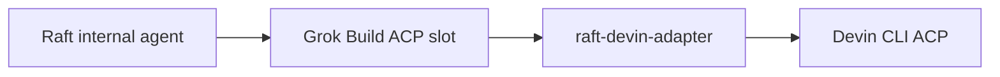

# raft-devin-adapter

[English](README.md) · [简体中文](README.zh-CN.md)

[](https://github.com/sealpp/raft-devin-adapter/actions/workflows/ci.yml)
[](LICENSE)
[](docs/compatibility.md)

**Run Devin CLI as an internal [Raft](https://raft.build) agent.** A small ACP compatibility adapter connects Raft's existing Grok Build runtime slot to your local Devin CLI, with native session resume, message injection, and model thinking controls.



The adapter translates protocol differences, so Devin can receive Raft messages while it works. It requires no agent-written inbox polling loop. Installation adds an independent launcher to your Windows user PATH; it does not patch the Raft application.

This is an **experimental, Windows-first community project**, independently maintained and unaffiliated with Raft, Cognition, or xAI. The runtime selector still says **Grok Build**, and this adapter occupies that local executable slot. See [compatibility and limits](docs/compatibility.md) before installing.

If this helps you bring Devin into your Raft workflow, **[give the project a Star](https://github.com/sealpp/raft-devin-adapter)** to follow its progress. Reports with CLI versions and reproducible examples are especially useful.

## What works

- Devin appears in Raft's model list with `Devin · …` names.
- Model selection and thinking strength use the native options offered by Devin.
- Raft standing instructions are forwarded as a marked instruction block on the first prompt of each launch or resume.
- Active-turn messages are delivered through Devin's mid-turn prompt capability.
- Host permission requests, streaming updates, and usage data are forwarded.
- Existing Devin session IDs can resume on the same computer, without replaying history into Raft.

The integration was exercised with **Raft Computer 1.0.63 / Devin CLI 3000.12.32** on Windows. See the [validation matrix](docs/compatibility.md) for the distinction between real Raft checks and offline protocol tests.

## Quick start on Windows

Prerequisites: **Node.js 22+**, Git, a working Raft Computer installation, and an installed and authenticated [Devin CLI](https://docs.devin.ai/). The launcher builds with the .NET Framework 4.x C# compiler included on supported Windows installations. Use the official Devin CLI for login, account configuration, and updates.

Run these commands in PowerShell:

```powershell
git clone https://github.com/sealpp/raft-devin-adapter.git
cd raft-devin-adapter
.\Install.ps1
.\Refresh-Models.ps1
.\Test-Adapter.ps1
```

If your local PowerShell policy blocks a script you have reviewed, you can run that script with `powershell.exe -NoProfile -ExecutionPolicy Bypass -File .\Install.ps1`. No npm packages are required to run the adapter.

In Raft, add an **internal agent**, choose **Grok Build**, refresh the model list, then select a `Devin · …` model. If Grok Build is absent from the Computer's runtime inventory, restart that Computer through its usual startup method so it inherits the new PATH. This briefly restarts its existing agents. The UI's workspace **Scan** action does not rescan installed runtimes.

`Refresh-Models.ps1` discovers thinking choices for each native model. `Test-Adapter.ps1` checks the compiled launcher's ACP handshake and model discovery. Both contact your installed Devin CLI; neither submits an inference prompt. If configuration checks fail, verify official Devin login and connectivity first.

If another `grok.exe` exists, installation stops. A real Grok installation cannot directly share this slot. To migrate an **older checkout of this adapter**, stop its agents and run `Install.ps1 -ReplaceAdapter`; the installer verifies the old executable's adapter identity before replacing its PATH entry. It preserves the previous user PATH in ignored local installation state.

## Select SWE-2 Max

In Raft, choose the **Devin SWE-2 model** and set **Reasoning effort → Max**. Keep Devin's model identifier as `swe-2-high`: Devin exposes its thinking level separately.

| Raft choice | Native Devin configuration |
| --- | --- |
| Model: Devin SWE-2 | `model = swe-2-high` |
| Reasoning: Medium / High / Max | `thought_level = medium / high / max` |
| Reasoning: Default | The selected model's native preset; SWE-2 currently uses High |

There is no fabricated `swe-2-max` model ID. The adapter validates the offered options and confirms the value returned by Devin. Unsupported strengths fail explicitly. For models whose native preset is `none`, Raft's **Default** retains that preset, because Raft's Grok parser does not accept `none` as an explicit strength.

After a Devin CLI update, run `Refresh-Models.ps1` again and refresh Raft's model list. A changed binary or model list invalidates the cached catalog. The currently selected model also exposes its live thinking options.

## Configuration and proxy

Defaults discover Devin under `%LOCALAPPDATA%\devin\cli\bin\devin.exe`, then PATH. Optional configuration is local to this checkout and ignored by Git:

```powershell
.\Install.ps1 -DevinExe 'C:\tools\devin\devin.exe' -ProxyUrl 'http://127.0.0.1:7890'
```

Or copy `adapter.config.example.json` to `adapter.config.json` and edit it. Use an empty proxy value to inherit the launch environment.

| Setting | Priority / behavior |
| --- | --- |
| Devin executable | `DEVIN_EXE` → local `devinExe` → standard install path → PATH |
| Proxy | `DEVIN_ADAPTER_PROXY` → local `proxyUrl` → inherited environment |
| Configuration file | `DEVIN_ADAPTER_CONFIG` → checkout's `adapter.config.json` |
| `defaultModel` | Fallback display ID if Devin omits its current model; native session settings take precedence |

An explicit proxy sets `HTTP_PROXY`, `HTTPS_PROXY`, and `ALL_PROXY` **for the Devin child process**. It does not start a proxy server, change the Windows system proxy, or require a specific proxy application. Your proxy service must already be running. Without an explicit value, the child inherits the environment of the Raft Computer process; environment inheritance alone does not guarantee Windows system-proxy routing. SOCKS support ultimately depends on the installed Devin CLI.

Local configuration persists across Raft updates because it lives outside Raft. This is separate from any global setting made by a proxy application. Do not commit proxy credentials or Devin account files.

## Development and checks

```powershell
npm ci
npm run check
npm test
.\Build.ps1
.\Test-Adapter.ps1 -Live
```

`npm test` uses a deterministic local ACP peer, with no account, network, model, or external tools. CI runs these protocol checks on Node 22/24 on Windows and Linux, and builds the Windows launcher. Linux CI does not establish live Linux Raft support.

`-Live` explicitly checks the real Devin SWE-2 Max, invalid-strength rejection, and Default/High behavior, without a model prompt. It needs a refreshed model catalog. Normal agent work uses your Devin account and credits.

See [architecture](docs/architecture.md), [contributing](CONTRIBUTING.md), and [security reporting](SECURITY.md).

## Update or uninstall

Stop agents using this checkout before rebuilding its launcher. Pull a reviewed update, run `Build.ps1`, refresh models, then start the agents again. If you move the checkout or change Node installations, rebuild and reinstall from the new location.

Raft upgrades do not overwrite this directory, but changes in Raft's Grok integration or Devin's ACP protocol may require adapter updates. Test compatibility after upgrading either product. Use official Devin commands for Devin updates; Raft's Grok login/update controls target the Grok runtime.

```powershell
.\Uninstall.ps1
```

Uninstall removes this checkout's entry from the user and current-shell PATH. It preserves source files, Devin sessions, and unrelated PATH entries. Restart the Computer to inherit the change, and stop or reconfigure agents using this slot. A previously migrated adapter entry is not automatically restored.

## License

[MIT](LICENSE). Raft, Devin, and Grok names belong to their respective owners. No vendor binaries, credentials, or copied Raft implementation files are distributed. Compatibility does not imply vendor endorsement.
