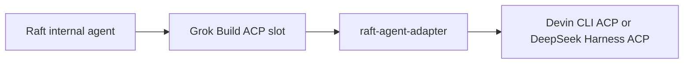

# raft-agent-adapter

[English](README.md) · [简体中文](README.zh-CN.md)

[](https://github.com/sealpp/raft-agent-adapter/actions/workflows/ci.yml)
[](LICENSE)
[](docs/compatibility.md)
[](https://github.com/sealpp/raft-agent-adapter/stargazers)

**Raft's internal agents can't use Devin CLI or DeepSeek Harness — this adapter fixes that.** Once installed, your chosen backend becomes a real runtime option: backend-prefixed models (`Devin · …` / `DSH · …`) show up in Raft's model picker, thinking strength maps to the backend's own levels, permission requests and streamed updates pass through, sessions resume later. Windows and Linux; Raft itself isn't touched.



The adapter translates between the two ACP dialects: Raft sees a Grok runtime, Devin sees an ACP host. Prompts, mid-turn messages, permission requests, streamed updates and usage data pass through both ways, and native Devin sessions can resume later without replaying history. Nothing inside Raft is patched — install just adds a `grok` executable to your PATH.

Heads-up before you install: this is an experimental community project, unaffiliated with Raft, Cognition, DeepSeek, or xAI, and the runtime selector will keep saying **Grok Build** — that's expected. [Compatibility and limits](docs/compatibility.md) is worth a skim.

If it works for you, a [star](https://github.com/sealpp/raft-agent-adapter) helps other people find it. Bug reports with CLI versions and repro steps are gold.

## What works

- The backend's models appear in Raft's model list with a `Devin · …` or `DSH · …` prefix.
- Model selection and thinking strength use the native options offered by the backend (`thought_level` on Devin, `reasoning_effort` on DeepSeek Harness).
- Raft standing instructions are forwarded as a marked instruction block on the first prompt of each launch or resume.
- Host permission requests, streaming updates, and usage data are forwarded.
- Existing session IDs can resume on the same computer, without replaying history into Raft.
- Devin only: active-turn messages are delivered through Devin's native mid-turn prompt capability.
- DeepSeek Harness only: mid-turn messages are queued and delivered automatically as the next prompt after the current turn finishes — dsh rejects a second in-flight prompt.

Verified **live end-to-end** on Linux — a real Raft server drove an agent through Raft Computer 1.0.67 → this adapter → a logged-in Devin CLI 3000.12.32, and a DM returned a real inference reply. The integration was originally exercised on Windows with Raft Computer 1.0.63. Full evidence breakdown: [validation matrix](docs/compatibility.md).

## Quick start on Linux

Prerequisites: **Node.js 22+**, Git, a working Raft Computer for Linux, and an installed and authenticated [Devin CLI](https://docs.devin.ai/). Install Devin with the official script and log in once:

```sh
curl -fsSL https://cli.devin.ai/install.sh | bash   # installs ~/.local/bin/devin
devin setup                                          # sign in (required for models)
```

Then install the adapter:

```sh
git clone https://github.com/sealpp/raft-agent-adapter.git
cd raft-agent-adapter
platform/linux/install.sh
npm run models:refresh
platform/linux/test-adapter.sh
```

`install.sh` builds the launcher and places a `grok` trampoline in `~/.local/bin` — the directory Raft checks on POSIX after `which grok`. `models:refresh` reads native thinking choices; `test-adapter.sh` checks the launcher's ACP handshake and model discovery. None of them submits an inference prompt.

In Raft, add an **internal agent**, choose **Grok Build**, refresh the model list, then select a backend-prefixed model (`Devin · …` or `DSH · …`). If Grok Build is absent from the Computer's runtime inventory, rescan runtimes or restart the Computer so it re-checks `~/.local/bin/grok`. The UI's workspace **Scan** action does not rescan installed runtimes.

## Quick start on Windows

Prerequisites: **Node.js 22+**, Git, a working Raft Computer installation, and an installed and authenticated [Devin CLI](https://docs.devin.ai/). The launcher builds with the .NET Framework 4.x C# compiler included on supported Windows installations. Use the official Devin CLI for login, account configuration, and updates.

Run these commands in PowerShell:

```powershell
git clone https://github.com/sealpp/raft-agent-adapter.git
cd raft-agent-adapter
.\platform\windows\Install.ps1
.\platform\windows\Refresh-Models.ps1
.\platform\windows\Test-Adapter.ps1
```

If your local PowerShell policy blocks a script you have reviewed, you can run that script with `powershell.exe -NoProfile -ExecutionPolicy Bypass -File .\platform\windows\Install.ps1`. No npm packages are required to run the adapter.

`Refresh-Models.ps1` discovers thinking choices for each native model. `Test-Adapter.ps1` checks the compiled launcher's ACP handshake and model discovery. Both contact your installed Devin CLI; neither submits an inference prompt. If configuration checks fail, verify official Devin login and connectivity first.

If another `grok.exe` exists, installation stops. A real Grok installation cannot directly share this slot. To migrate an **older checkout of this adapter**, stop its agents and run `Install.ps1 -ReplaceAdapter`; the installer verifies the old executable's adapter identity before replacing its PATH entry. It preserves the previous user PATH in ignored local installation state. On Linux the equivalent is `install.sh --replace-adapter`.

## DeepSeek Harness backend

DeepSeek Harness (`dsh`) speaks ACP through `dsh acp` (the npm package `@deepseek-ai/dsh` ships the profile). Point the adapter at it by setting `"backend": "dsh"` in `adapter.config.json`, then refresh models. The adapter runs `dsh acp` by default; override with `dshExe` / `dshArgs`.

Protocol differences handled by the adapter:

- dsh reports `sessionCapabilities: { close, list, resume }` — no `loadSession`. Raft's Grok driver requires `loadSession: true`, so the adapter injects it and maps `session/load` → `session/resume`. Resume failures (`not resumable`, `cwd does not match`) are translated into the missing-session shape so Raft auto-opens a fresh session — no manual reset needed.
- dsh has no `session/delete`; `session/close` is used instead. Closed sessions remain in `session/list`, which is expected dsh behavior.
- Model choices may arrive as grouped nested options whose values are JSON `[provider, model]` pairs; the adapter flattens them into `dsh:<value>` IDs.
- The primed catalog session is persisted in adapter-local state and reused across launches via `session/list` + `session/resume`, so repeated Raft runtime probes do not pile up dead sessions.
- A prompt that is already in flight cannot take an interjection. Queued interjections are sent as the next `session/prompt` once the active turn completes.

dsh startup (`dsh acp` boots a Cordis kernel) can approach Raft's ~15s model-detection window. The adapter answers `initialize` immediately, so detection passes; the kernel is spawned lazily on the first session call. Configure providers and keys in `~/.dsh` (`dsh web` or the yaml files) before pointing Raft at it.

## Switching backends

Raft does not know which backend sits behind the `grok` slot — switching `backend` changes models, session IDs, and thinking-option vocabulary without Raft noticing. After a switch: refresh Raft's model list and re-pick a `…`-prefixed model; old stored model IDs and session IDs belonging to the other backend are rejected with a clear error rather than silently misrouted. Starting a fresh session (or letting the resume fallback create one) is the cleanest reset path.

## Select SWE-2 Max

In Raft, choose the **Devin SWE-2 model** and set **Reasoning effort → Max**. Keep Devin's model identifier as `swe-2-high`: Devin exposes its thinking level separately.

| Raft choice | Native Devin configuration |
| --- | --- |
| Model: Devin SWE-2 | `model = swe-2-high` |
| Reasoning: Medium / High / Max | `thought_level = medium / high / max` |
| Reasoning: Default | The selected model's native preset; SWE-2 currently uses High |

There is no fabricated `swe-2-max` model ID. The adapter validates the offered options and confirms the value returned by Devin. Unsupported strengths fail explicitly. For models whose native preset is `none`, Raft's **Default** retains that preset, because Raft's Grok parser does not accept `none` as an explicit strength.

After a Devin CLI update, refresh the catalog (`platform/linux/refresh-models.sh`, `platform\windows\Refresh-Models.ps1`, or `npm run models:refresh`) and refresh Raft's model list. A changed binary or model list invalidates the cached catalog. The currently selected model also exposes its live thinking options.

## Configuration and proxy

Defaults discover Devin at the standard standalone install location — `%LOCALAPPDATA%\devin\cli\bin\devin.exe` on Windows, `~/.local/bin/devin` (plus its `_versions/current` target) on macOS/Linux — then PATH. Optional configuration is local to this checkout and ignored by Git:

```sh
platform/linux/install.sh --devin-exe /opt/devin/devin --proxy-url http://127.0.0.1:7890
```

```powershell
.\platform\windows\Install.ps1 -DevinExe 'C:\tools\devin\devin.exe' -ProxyUrl 'http://127.0.0.1:7890'
```

Or copy `adapter.config.example.json` to `adapter.config.json` and edit it. Use an empty proxy value to inherit the launch environment.

| Setting | Priority / behavior |
| --- | --- |
| `backend` | `RAFT_ADAPTER_BACKEND` → local `backend` → `devin` |
| Devin executable | `DEVIN_EXE` → local `devinExe` → standard install path → PATH |
| dsh executable | `DSH_EXE` → local `dshExe` → `dsh` on PATH; args default to `acp` via `dshArgs` |
| Proxy | `RAFT_ADAPTER_PROXY` → `DEVIN_ADAPTER_PROXY` → local `proxyUrl` → inherited environment |
| Configuration file | `RAFT_ADAPTER_CONFIG` → `DEVIN_ADAPTER_CONFIG` → checkout's `adapter.config.json` |
| `defaultModel` | Fallback display ID if the backend omits its current model; native session settings take precedence |

An explicit proxy sets `HTTP_PROXY`, `HTTPS_PROXY`, and `ALL_PROXY` **for the backend child process**. It does not start a proxy server, change the system proxy, or require a specific proxy application. Your proxy service must already be running. Without an explicit value, the child inherits the environment of the Raft Computer process; environment inheritance alone does not guarantee system-proxy routing. SOCKS support ultimately depends on the installed Devin CLI.

Local configuration persists across Raft updates because it lives outside Raft. This is separate from any global setting made by a proxy application. Do not commit proxy credentials or Devin account files.

## Update or uninstall

Stop agents using this checkout before rebuilding its launcher. Pull a reviewed update, rebuild (`platform/linux/build.sh` or `platform\windows\Build.ps1`), refresh models, then start the agents again. If you move the checkout or change Node installations, rebuild and reinstall from the new location.

Raft upgrades do not overwrite this directory, but changes in Raft's Grok integration or Devin's ACP protocol may require adapter updates. Test compatibility after upgrading either product. Use official Devin commands for Devin updates; Raft's Grok login/update controls target the Grok runtime.

```sh
platform/linux/uninstall.sh        # Linux
```

```powershell
.\platform\windows\Uninstall.ps1   # Windows
```

Uninstall removes this checkout's entry from PATH (the `~/.local/bin/grok` trampoline on Linux; the user PATH entry on Windows). It preserves source files, Devin sessions, and unrelated PATH entries. Restart the Computer or rescan runtimes to inherit the change, and stop or reconfigure agents using this slot. A previously migrated adapter entry is not automatically restored.

## Development and checks

```sh
npm ci
npm run check
npm test
platform/linux/build.sh          # or platform\windows\Build.ps1
platform/linux/test-adapter.sh --live   # or Test-Adapter.ps1 -Live
```

`npm test` uses a deterministic local ACP peer, with no account, network, model, or external tools. CI runs these protocol checks on Node 22/24 on Windows and Linux, builds both launchers, and smoke-tests the full chain through the built launcher against the fake peer. A separate job builds the Docker verification image without external downloads.

`--live` explicitly checks the real Devin SWE-2 Max, invalid-strength rejection, and Default/High behavior, without a model prompt. It needs a refreshed model catalog. Normal agent work uses your Devin account and credits.

### Docker development sandbox

A self-contained Linux environment (Node 22 + Devin CLI, optional Raft Computer) is provided for development and verification:

```sh
docker build -f docker/Dockerfile -t raft-agent-adapter .   # build verifies the whole chain
docker run --rm raft-agent-adapter                          # re-run the verification suite
docker run -it raft-agent-adapter bash                      # interactive shell
docker build -f docker/Dockerfile --build-arg INSTALL_RAFT=1 -t raft-agent-adapter .   # + raft-computer
```

The build runs offline protocol tests, builds the launcher, installs `grok` on PATH, and drives the same ACP sequence Raft uses — including a real `devin acp` handshake without inference. See [docs/docker.md](docs/docker.md) for authenticated testing (`DEVIN_API_KEY`) and connecting Raft Computer.

See [architecture](docs/architecture.md), [contributing](CONTRIBUTING.md), [docker](docs/docker.md), and [security reporting](SECURITY.md).

## License

[MIT](LICENSE). Raft, Devin, DeepSeek, and Grok names belong to their respective owners. No vendor binaries, credentials, or copied Raft implementation files are distributed. Compatibility does not imply vendor endorsement.
