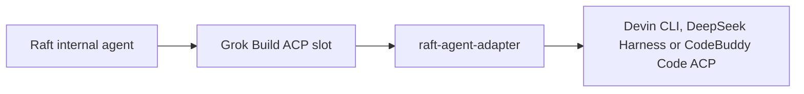

# raft-agent-adapter

[English](README.md) · [简体中文](README.zh-CN.md)

[](https://github.com/sealpp/raft-agent-adapter/actions/workflows/ci.yml)
[](LICENSE)
[](docs/compatibility.md)
[](https://github.com/sealpp/raft-agent-adapter/stargazers)

**Raft's internal agents can't use Devin CLI, DeepSeek Harness or CodeBuddy Code — this adapter fixes that.** Once installed, your chosen backend becomes a real runtime option: backend-prefixed models (`Devin · …` / `DSH · …` / `CodeBuddy · …`) show up in Raft's model picker, thinking strength maps to the backend's own levels, permission requests and streamed updates pass through, sessions resume later. Windows and Linux; Raft itself isn't touched.



The adapter translates between the two ACP dialects: Raft sees a Grok runtime, and the chosen backend sees an ACP host. Prompts, permission requests, streamed updates and usage data pass through both ways, and native sessions can resume later without replaying history. Nothing inside Raft is patched — install just adds a `grok` executable to your PATH. One backend is active per installation, selected by the `backend` setting.

Heads-up before you install: this is an experimental community project, unaffiliated with Raft, Cognition, DeepSeek, or xAI, and the runtime selector will keep saying **Grok Build** — that's expected. [Compatibility and limits](docs/compatibility.md) is worth a skim.

If it works for you, a [star](https://github.com/sealpp/raft-agent-adapter) helps other people find it. Bug reports with CLI versions and repro steps are gold.

**Setting this up with an AI agent?** [AGENTS.md](AGENTS.md) has a condensed runbook: capability boundaries, backend selection, install sequence, failure handling.

## What works

- The backend's models appear in Raft's model list with a `Devin · …` or `DSH · …` prefix.
- Model selection and thinking strength use the native options offered by the backend (`thought_level` on Devin, `reasoning_effort` on DeepSeek Harness).
- Raft standing instructions are forwarded as a marked instruction block on the first prompt of each launch or resume.
- Host permission requests, streaming updates, and usage data are forwarded.
- Existing session IDs can resume on the same computer, without replaying history into Raft.
- Devin only: active-turn messages are delivered through Devin's native mid-turn prompt capability.
- DeepSeek Harness only: mid-turn messages are queued and delivered automatically as the next prompt after the current turn finishes — dsh rejects a second in-flight prompt.
- CodeBuddy Code only: active-turn messages are queued and delivered after the current turn, like DeepSeek Harness.
- Devin and CodeBuddy Code sessions open with the backend's most permissive mode (`bypass` / `fullAccess`) — the same no-approval posture Raft gives Codex.

Devin CLI was verified **live end-to-end** on Linux — a real Raft server drove an agent through Raft Computer 1.0.67 → this adapter → a logged-in Devin CLI 3000.12.32, and a DM returned a real inference reply. That run predates the multi-backend refactor. DeepSeek Harness has not yet been run against a real `dsh` binary. CodeBuddy Code 2.179.3 was run through the adapter with a signed-in China-site account: the handshake, the 17-model catalog with per-model thinking levels, model and thinking selection, one real prompt that finished with `end_turn`, and a cross-process session load. Mid-turn behavior was checked with two overlapping prompts: CodeBuddy queues the second one and runs it after the first, but acknowledges it at once. Permission prompts are not yet validated. Earlier checks without an account covered the handshake, the thinking catalog, adapter-local session deletion, and the sign-in refusal. The integration was originally exercised on Windows with Raft Computer 1.0.63. Full evidence breakdown: [validation matrix](docs/compatibility.md).

## Quick start on Linux

Prerequisites: **Node.js 22+**, Git, a working Raft Computer for Linux, and an installed and authenticated [Devin CLI](https://docs.devin.ai/). Install Devin with the official script and log in once (for DeepSeek Harness, see [its section](#deepseek-harness-backend)):

```sh
curl -fsSL https://cli.devin.ai/install.sh | bash   # installs ~/.local/bin/devin
devin setup                                          # sign in (required for models)
```

Then install the adapter:

```sh
git clone https://github.com/sealpp/raft-agent-adapter.git
cd raft-agent-adapter
platform/linux/install.sh
npm run models:refresh
platform/linux/test-adapter.sh
```

`install.sh` builds the launcher and places a `grok` trampoline in `~/.local/bin` — the directory Raft checks on POSIX after `which grok`. `models:refresh` reads native thinking choices; `test-adapter.sh` checks the launcher's ACP handshake and model discovery. None of them submits an inference prompt.

In Raft, add an **internal agent**, choose **Grok Build**, refresh the model list, then select a backend-prefixed model (`Devin · …` or `DSH · …`). If Grok Build is absent from the Computer's runtime inventory, rescan runtimes or restart the Computer so it re-checks `~/.local/bin/grok`. The UI's workspace **Scan** action does not rescan installed runtimes.

## Quick start on Windows

Prerequisites: **Node.js 22+**, Git, a working Raft Computer installation, and an installed and authenticated [Devin CLI](https://docs.devin.ai/). The launcher builds with the .NET Framework 4.x C# compiler included on supported Windows installations. Use the official Devin CLI for login, account configuration, and updates.

Run these commands in PowerShell:

```powershell
git clone https://github.com/sealpp/raft-agent-adapter.git
cd raft-agent-adapter
.\platform\windows\Install.ps1
.\platform\windows\Refresh-Models.ps1
.\platform\windows\Test-Adapter.ps1
```

If your local PowerShell policy blocks a script you have reviewed, you can run that script with `powershell.exe -NoProfile -ExecutionPolicy Bypass -File .\platform\windows\Install.ps1`. No npm packages are required to run the adapter.

`Refresh-Models.ps1` discovers thinking choices for each native model. `Test-Adapter.ps1` checks the compiled launcher's ACP handshake and model discovery. Both contact your installed Devin CLI; neither submits an inference prompt. If configuration checks fail, verify official Devin login and connectivity first.

If another `grok.exe` exists, installation stops: a real Grok installation cannot share this slot, and only one checkout of this adapter can own it. Run the other checkout's `Uninstall.ps1` first. The installer keeps a copy of your previous user PATH in ignored local installation state. On Linux, `install.sh` stops the same way if another `grok` is on PATH; run that checkout's `uninstall.sh` first.

## DeepSeek Harness backend

DeepSeek Harness (`dsh`) speaks ACP through `dsh acp` (the npm package `@deepseek-ai/dsh` ships the profile). Point the adapter at it by setting `"backend": "dsh"` in `adapter.config.json`, then refresh models. The adapter runs `dsh acp` by default; override with `dshExe` / `dshArgs`.

Protocol differences handled by the adapter:

- dsh reports `sessionCapabilities: { close, list, resume }` — no `loadSession`. Raft's Grok driver requires `loadSession: true`, so the adapter injects it and maps `session/load` → `session/resume`. Resume failures (`not resumable`, `cwd does not match`) are translated into the missing-session shape so Raft auto-opens a fresh session — no manual reset needed.
- dsh has no `session/delete`; `session/close` is used instead. Closed sessions remain in `session/list`, which is expected dsh behavior.
- Model choices may arrive as grouped nested options whose values are JSON `[provider, model]` pairs; the adapter flattens them into `dsh:<value>` IDs.
- The primed catalog session's ID is kept in adapter-local state and resumed with `session/resume` on later launches, so repeated Raft runtime probes do not leave new dead sessions. `npm run models:refresh` still opens one session per run; dsh keeps it listed because it cannot delete sessions.
- A prompt that is already in flight cannot take an interjection. Queued interjections are sent as the next `session/prompt` once the active turn completes.

`dsh acp` boots a Cordis plugin kernel, and `initialize` waits for that kernel and the primed catalog session before it answers. The cold-start time has not been measured. If it exceeds Raft's model-detection window (about 15 seconds), Raft will not list DeepSeek models. Configure providers and keys in `~/.dsh` (`dsh web` or the yaml files) before pointing Raft at it.

## CodeBuddy Code backend

CodeBuddy Code runs as `codebuddy --acp` (npm package `@tencent-ai/codebuddy-code`). Set `"backend": "codebuddy"` in `adapter.config.json` (or `RAFT_ADAPTER_BACKEND=codebuddy`), then refresh models. The adapter looks for `codebuddy` on PATH; set `codebuddyExe` / `CODEBUDDY_EXE` to use another binary and `codebuddyArgs` to change its arguments. `auto` never selects CodeBuddy.

Sign in first. Without credentials `session/new` fails with `Authentication required`, which Raft shows as not authenticated. Either run `codebuddy` once on this computer and finish the sign-in, or set `CODEBUDDY_API_KEY` in the environment that starts Raft (and `CODEBUDDY_INTERNET_ENVIRONMENT` as CodeBuddy's documentation describes for its China and iOA sites). The adapter never forwards `authenticate` for this backend: CodeBuddy's sign-in is interactive and logs out the current account first.

Protocol differences handled by the adapter:

- The CLI has no `session/close`, `session/delete` or `session/list`. Closing a session only forgets it in the adapter; the CLI keeps it under `~/.codebuddy/projects/`.
- Every `session/new` is written to disk immediately, so the primed catalog session is kept in `.local/backend-state.json` and resumed, as on DeepSeek Harness.
- Thinking levels differ per model. `npm run models:refresh` records each model's levels in the catalog.
- Active-turn messages are queued and delivered after the current turn. CodeBuddy also queues a second prompt sent mid-turn but acknowledges it at once with `end_turn`, so the adapter sends interjections only after the current turn and keeps the Raft turn open until they have run.
- Permission mode is set to `fullAccess` through `session/set_config_option` every time a session opens (new, resumed or loaded): a true full pass that skips all permission prompts, including dangerous-command checks — the same posture Raft gives Codex (`approvalPolicy: "never"` + `sandbox_mode: "danger-full-access"`). Explicit `deny` rules still apply. CodeBuddy also offers `default` (Always Ask), `acceptEdits`, `plan`, `auto`, `dontAsk` and `bypassPermissions`; the adapter does not expose a switch for them. If a CodeBuddy build lacks the `mode` option, the adapter logs a warning and opens the session anyway.
- Token usage arrives as per-request `usage_update` notifications instead of in the prompt result. The adapter sums them into the prompt's `_meta.usage` in ACP's usage shape (`inputTokens`, `outputTokens`, `totalTokens`) and forwards the notifications unchanged. Cache and reasoning counts are not reported separately. Verified live: the result equals the deduplicated sum of the per-request updates. In the checked requests, cache hits were part of the prompt tokens, and reasoning tokens are assumed to sit inside the completion total.

Known limitation: the adapter records the sessions it creates under `.local/codebuddy-sessions/`. A `session/load` for any other session ID is reported as `session not found`, so Raft starts a fresh session as it does for DSH. Sessions created directly in the `codebuddy` terminal UI are therefore not resumed through Raft. Another edge case: if you delete a session's file on disk, the adapter still treats its ID as known, and CodeBuddy recreates it as an empty session on resume. Deleting `.local/` (or using a fresh checkout without it) also forgets the record. Verified against CodeBuddy 2.147.0 and 2.179.3 on Linux. CodeBuddy releases often, so refresh models and rerun the handshake after each upgrade.

One live-run observation on deferred interjections: the follow-up's reply streamed inside the Raft turn in one run and a few milliseconds after the turn's response in another. ACP does not guarantee that a prompt's `session/update` notifications all precede its response, so a reply can land just past the turn boundary; how Raft attributes such trailing updates is unverified.

## Switching backends

Raft does not know which backend sits behind the `grok` slot — switching `backend` changes models, session IDs, and thinking-option vocabulary without Raft noticing. After a switch, refresh Raft's model list and re-pick a backend-prefixed model. A stored model ID from the other backend is rejected with a clear error instead of being misrouted. On DeepSeek Harness, an unknown session ID is reported as missing, so Raft starts a fresh session; on Devin, resume errors pass through unchanged.

## Select SWE-2 Max

In Raft, choose the **Devin SWE-2 model** and set **Reasoning effort → Max**. Keep Devin's model identifier as `swe-2-high`: Devin exposes its thinking level separately.

| Raft choice | Native Devin configuration |
| --- | --- |
| Model: Devin SWE-2 | `model = swe-2-high` |
| Reasoning: Medium / High / Max | `thought_level = medium / high / max` |
| Reasoning: Default | The selected model's native preset; SWE-2 currently uses High |

There is no fabricated `swe-2-max` model ID. The adapter validates the offered options and confirms the value returned by Devin. Unsupported strengths fail explicitly. For models whose native preset is `none`, Raft's **Default** retains that preset, because Raft's Grok parser does not accept `none` as an explicit strength.

After a Devin CLI update, refresh the catalog (`platform/linux/refresh-models.sh`, `platform\windows\Refresh-Models.ps1`, or `npm run models:refresh`) and refresh Raft's model list. A changed binary or model list invalidates the cached catalog. The currently selected model also exposes its live thinking options.

## Configuration and proxy

Defaults discover Devin at the standard standalone install location — `%LOCALAPPDATA%\devin\cli\bin\devin.exe` on Windows, `~/.local/bin/devin` (plus its `_versions/current` target) on macOS/Linux — then PATH. Optional configuration is local to this checkout and ignored by Git:

```sh
platform/linux/install.sh --devin-exe /opt/devin/devin --proxy-url http://127.0.0.1:7890
```

```powershell
.\platform\windows\Install.ps1 -DevinExe 'C:\tools\devin\devin.exe' -ProxyUrl 'http://127.0.0.1:7890'
```

Or copy `adapter.config.example.json` to `adapter.config.json` and edit it. Use an empty proxy value to inherit the launch environment.

| Setting | Priority / behavior |
| --- | --- |
| `backend` | `RAFT_ADAPTER_BACKEND` → local `backend` → `auto` (Devin if its CLI is found, otherwise DeepSeek Harness; never CodeBuddy) |
| Devin executable | `DEVIN_EXE` → local `devinExe` → standard install path → PATH |
| dsh executable | `DSH_EXE` → local `dshExe` → `dsh` on PATH; args default to `acp` via `dshArgs` |
| CodeBuddy executable | `CODEBUDDY_EXE` → local `codebuddyExe` → `codebuddy` on PATH; args default to `--acp` via `codebuddyArgs` |
| Proxy | `RAFT_ADAPTER_PROXY` → local `proxyUrl` → inherited environment |
| Configuration file | `RAFT_ADAPTER_CONFIG` → checkout's `adapter.config.json` |
| `defaultModel` | Fallback display ID if the backend omits its current model; native session settings take precedence |

An explicit proxy sets `HTTP_PROXY`, `HTTPS_PROXY`, and `ALL_PROXY` **for the backend child process**. It does not start a proxy server, change the system proxy, or require a specific proxy application. Your proxy service must already be running. Without an explicit value, the child inherits the environment of the Raft Computer process; environment inheritance alone does not guarantee system-proxy routing. SOCKS support ultimately depends on the installed backend CLI.

Local configuration persists across Raft updates because it lives outside Raft. This is separate from any global setting made by a proxy application. Do not commit proxy credentials or Devin account files.

## Update or uninstall

Stop agents using this checkout before rebuilding its launcher. Pull a reviewed update, rebuild (`platform/linux/build.sh` or `platform\windows\Build.ps1`), refresh models, then start the agents again. If you move the checkout or change Node installations, rebuild and reinstall from the new location.

Raft upgrades do not overwrite this directory, but changes in Raft's Grok integration or Devin's ACP protocol may require adapter updates. Test compatibility after upgrading either product. Use official Devin commands for Devin updates; Raft's Grok login/update controls target the Grok runtime.

```sh
platform/linux/uninstall.sh        # Linux
```

```powershell
.\platform\windows\Uninstall.ps1   # Windows
```

Uninstall removes this checkout's entry from PATH (the `~/.local/bin/grok` trampoline on Linux; the user PATH entry on Windows). It preserves source files, agent sessions, and unrelated PATH entries. Restart the Computer or rescan runtimes to inherit the change, and stop or reconfigure agents using this slot.

## Development and checks

```sh
npm ci
npm run check
npm test
platform/linux/build.sh          # or platform\windows\Build.ps1
platform/linux/test-adapter.sh --live   # or Test-Adapter.ps1 -Live
```

`npm test` uses a deterministic local ACP peer, with no account, network, model, or external tools. CI runs these protocol checks on Node 22/24 on Windows and Linux, builds both launchers, and smoke-tests the full chain through the built launcher against the fake peer. A separate job builds the Docker verification image without external downloads.

`--live` explicitly checks the real Devin SWE-2 Max, invalid-strength rejection, and Default/High behavior, without a model prompt. It needs a refreshed model catalog. Normal agent work uses your Devin account and credits.

### Docker development sandbox

A self-contained Linux environment (Node 22 + Devin CLI, optional Raft Computer) is provided for development and verification:

```sh
docker build -f docker/Dockerfile -t raft-agent-adapter .   # build verifies the whole chain
docker run --rm raft-agent-adapter                          # re-run the verification suite
docker run -it raft-agent-adapter bash                      # interactive shell
docker build -f docker/Dockerfile --build-arg INSTALL_RAFT=1 -t raft-agent-adapter .   # + raft-computer
```

The build runs offline protocol tests, builds the launcher, installs `grok` on PATH, and drives the same ACP sequence Raft uses — including a real `devin acp` handshake without inference. See [docs/docker.md](docs/docker.md) for authenticated testing (`DEVIN_API_KEY`) and connecting Raft Computer.

See [architecture](docs/architecture.md), [contributing](CONTRIBUTING.md), [docker](docs/docker.md), and [security reporting](SECURITY.md).

## License

[MIT](LICENSE). Raft, Devin, DeepSeek, and Grok names belong to their respective owners. No vendor binaries, credentials, or copied Raft implementation files are distributed. Compatibility does not imply vendor endorsement.
