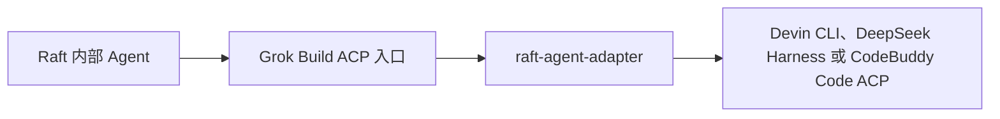

# raft-agent-adapter

[English](README.md) · [简体中文](README.zh-CN.md)

[](https://github.com/sealpp/raft-agent-adapter/actions/workflows/ci.yml)
[](LICENSE)
[](docs/compatibility.md)
[](https://github.com/sealpp/raft-agent-adapter/stargazers)

**Raft 的内部 Agent 本来用不了 Devin CLI、DeepSeek Harness 和 CodeBuddy Code——这个适配器让它们能用。** 装好之后所选后端就是一个真实运行时：模型列表里出现带前缀的选项（`Devin · …` / `DSH · …` / `CodeBuddy · …`），思考强度按后端自己的档位走，权限请求、流式更新照常转发，会话能续上。Windows 和 Linux 都行，不动 Raft 本身。



适配器在两头各说各的协议：对 Raft 它是一个 Grok 运行时，对后端它是一个 ACP 主机。提示、权限请求、流式更新和用量都如实转发，已有的会话也能直接续上，不会把历史重放进 Raft。不改 Raft 任何文件——安装只是往 PATH 加一个 `grok` 可执行文件。一个适配器实例同时只接一个后端，用 `backend` 配置项选择。

装之前先说清楚：这是实验性社区项目，跟 Raft、Cognition、DeepSeek、xAI 没有隶属关系，运行时选择器会一直显示 **Grok Build**——属正常现象。建议先扫一眼[兼容范围与限制](docs/compatibility.md)。

好用的话点个 [star](https://github.com/sealpp/raft-agent-adapter)，让更多人能找到它。报 bug 时带上 CLI 版本和复现步骤，最有帮助。

## 已实现能力

- 在 Raft 模型列表中展示带 `Devin · …` / `DSH · …` / `CodeBuddy · …` 前缀的模型。
- 根据后端实际返回的选项，选择模型和思考强度（Devin 的 `thought_level`，dsh 的 `reasoning_effort`）。
- 将 Raft 的角色常驻指令作为有标记的指令块，附加到每次启动或恢复后的第一条提示。
- 转发权限请求、流式更新和用量数据。
- 在同一台电脑上使用原会话 ID 恢复会话，并抑制历史回放重复写入 Raft。
- Devin 专用：中途消息通过 Devin 原生 mid-turn prompt 能力送达。
- dsh 专用：dsh 拒绝同会话第二个在途 prompt，中途消息会入队，在当前轮结束后自动作为下一轮提示补发。
- CodeBuddy Code 专用：在途消息会入队，在当前轮结束后作为下一轮提示投递。

Devin CLI 已在 Linux 上完成**真实端到端验证**：真实 Raft 服务器经由 Raft Computer 1.0.67 → 本适配器 → 已登录的 Devin CLI 3000.12.32 驱动 Agent，向其发送 DM 返回了真实模型推理回复。该次验证早于多后端重构；DeepSeek Harness 尚未对真实 `dsh` 二进制完成验证。CodeBuddy Code 2.179.3 已通过适配器接入国内版已登录账号完成验证：握手、含逐模型思考档位的 17 个模型目录、模型与思考强度选择、一次以 `end_turn` 结束的真实 prompt，以及跨进程的会话加载。在途行为已用两条重叠的 prompt 检查：CodeBuddy 会排队第二条并在第一条结束后执行，但会立即确认。权限请求尚未验证。此前不登录账号的检查覆盖了握手、思考档位目录、适配器本地删除会话和未登录拒绝。集成最初在 Windows 上使用 Raft Computer 1.0.63 验证。完整证据分级见[验证矩阵](docs/compatibility.md)。

## Linux 快速开始

准备 **Node.js 22+**、Git、可用的 Linux 版 Raft Computer，以及已安装并完成登录的 [Devin CLI](https://docs.devin.ai/)。先用官方脚本安装 Devin 并登录一次（使用 DeepSeek Harness 请见[对应章节](#deepseek-harness-后端)）：

```sh
curl -fsSL https://cli.devin.ai/install.sh | bash   # 安装到 ~/.local/bin/devin
devin setup                                          # 登录（模型列表需要）
```

然后安装适配器：

```sh
git clone https://github.com/sealpp/raft-agent-adapter.git
cd raft-agent-adapter
platform/linux/install.sh
npm run models:refresh
platform/linux/test-adapter.sh
```

`install.sh` 构建启动器并在 `~/.local/bin` 放一个 `grok` 引导脚本——这正是 Raft 在 POSIX 上 `which grok` 失败后的回退查找目录。`models:refresh` 读取各模型的原生思考选项；`test-adapter.sh` 检查启动器的 ACP 握手和模型发现。以上命令都不会提交模型推理提示。

在 Raft 中添加**内部 Agent**，运行时选择 **Grok Build**，刷新模型列表后选择带后端前缀的模型（`Devin · …` 或 `DSH · …`）。如果 Computer 的运行时清单里没有 Grok Build，请 Rescan Runtimes 或重启该 Computer，让它重新检查 `~/.local/bin/grok`。界面里的工作区 **Scan** 不会重新扫描已安装的运行时。

## Windows 快速开始

准备 **Node.js 22+**、Git、可用的 Raft Computer，以及已安装并完成登录的 [Devin CLI](https://docs.devin.ai/)。启动器使用 Windows 上 .NET Framework 4.x 自带的 C# 编译器构建。Devin 登录、账户配置和更新均通过官方 CLI 完成。

在 PowerShell 中执行：

```powershell
git clone https://github.com/sealpp/raft-agent-adapter.git
cd raft-agent-adapter
.\platform\windows\Install.ps1
.\platform\windows\Refresh-Models.ps1
.\platform\windows\Test-Adapter.ps1
```

若本机 PowerShell 执行策略阻止了你已审阅的脚本，可对单个脚本使用 `powershell.exe -NoProfile -ExecutionPolicy Bypass -File .\platform\windows\Install.ps1`。运行适配器不需要安装 npm 依赖。

`Refresh-Models.ps1` 会读取各模型的原生思考选项；`Test-Adapter.ps1` 会检查编译后启动器的 ACP 握手和模型发现。两者都会访问本机 Devin CLI，均不会提交模型推理提示。配置检查失败时，先确认官方 Devin 登录和网络正常。

若已存在另一个 `grok.exe`，安装会停止：真实 Grok 安装无法共用此入口，同一时间也只能由一个适配器检出目录占用它。请先在另一个检出目录运行 `Uninstall.ps1`。原用户 PATH 会备份到被 Git 忽略的本地安装状态中。Linux 下若 PATH 上已有其他 `grok`，`install.sh` 同样会停止，请先在该检出目录运行 `uninstall.sh`。

## DeepSeek Harness 后端

DeepSeek Harness（`dsh`）通过 `dsh acp` 提供 ACP（npm 包 `@deepseek-ai/dsh` 自带该 profile）。在 `adapter.config.json` 里设 `"backend": "dsh"` 并刷新模型即可切换；默认执行 `dsh acp`，可用 `dshExe` / `dshArgs` 覆盖。

适配器处理的协议差异：

- dsh 只报告 `sessionCapabilities: { close, list, resume }`，没有 `loadSession`。Raft 的 Grok driver 硬性要求 `loadSession: true`，适配器会注入该能力并把 `session/load` 映射为 `session/resume`；resume 失败（`not resumable`、`cwd does not match`）会翻译成 missing-session 形态，让 Raft 自动开新会话，无需手动重置。
- dsh 没有 `session/delete`，只有 `session/close`；关闭的会话仍留在 `session/list`，属 dsh 正常行为。
- 模型选项可能是分组嵌套结构，value 是 `[provider, model]` 的 JSON 字符串；适配器会扁平化为 `dsh:<value>` 形式的 ID。
- 用于探测模型目录的 primed 会话 ID 保存在适配器本地状态中，后续启动通过 `session/resume` 续用，Raft 反复探测不会留下新的废弃会话。`npm run models:refresh` 每次仍会开一个会话，dsh 无法删除，因此它会留在会话列表中。
- 在途 prompt 期间收到的插话会入队，当前轮结束后自动作为下一条 `session/prompt` 补发。

`dsh acp` 启动的是 Cordis 插件内核。`initialize` 要等内核和 primed 会话就绪后才应答，冷启动耗时尚未实测。若超过 Raft 约 15 秒的模型探测窗口，Raft 将列不出 DSH 模型。接入前请先在 `~/.dsh` 配好 provider 与凭据（可用 `dsh web` 或直接编辑 yaml）。

## CodeBuddy Code 后端

CodeBuddy Code 通过 `codebuddy --acp` 提供 ACP（npm 包 `@tencent-ai/codebuddy-code`）。在 `adapter.config.json` 里设 `"backend": "codebuddy"`（或 `RAFT_ADAPTER_BACKEND=codebuddy`）并刷新模型。适配器在 PATH 上查找 `codebuddy`；用 `codebuddyExe` / `CODEBUDDY_EXE` 指定其他可执行文件，用 `codebuddyArgs` 修改参数。`auto` 从不自动选择 CodeBuddy。

先完成登录。没有凭据时 `session/new` 会报 `Authentication required`，Raft 会将其显示为未认证。二选一：在本机运行一次 `codebuddy` 并完成登录，或在启动 Raft 的环境中设置 `CODEBUDDY_API_KEY`（国内版和 iOA 站点按 CodeBuddy 文档设置 `CODEBUDDY_INTERNET_ENVIRONMENT`）。该后端下适配器从不转发 `authenticate`：CodeBuddy 的登录是交互式的，会先登出当前账户。

适配器处理的协议差异：

- CLI 没有 `session/close`、`session/delete` 和 `session/list`。关闭会话只会在适配器内部忘记它；CLI 仍把它保存在 `~/.codebuddy/projects/` 下。
- 每次 `session/new` 都会立即落盘，因此 primed 目录会话 ID 保存在 `.local/backend-state.json` 中并续用，与 DeepSeek Harness 相同。
- 思考档位按模型不同。`npm run models:refresh` 会把每个模型的档位记录进目录。
- 在途消息会入队，在当前轮结束后投递。CodeBuddy 本身也会排队第二条在途 prompt，但会立即以 `end_turn` 确认，因此适配器只在当前轮结束后发送插话，并保持 Raft 轮次打开，直到插话执行完毕。
- 权限模式在每次会话打开时（新建、续用或加载）通过 `session/set_config_option` 设为 `fullAccess`：真正的全放行，跳过所有权限提示，包括危险命令检查——与 Raft 给 Codex 的配置一致（`approvalPolicy: "never"` + `sandbox_mode: "danger-full-access"`）。显式 `deny` 规则仍然生效。CodeBuddy 还提供 `default`（Always Ask）、`acceptEdits`、`plan`、`auto`、`dontAsk` 和 `bypassPermissions`，适配器目前不提供切换入口。若某个 CodeBuddy 版本没有 `mode` 配置项，适配器会记录警告并照常打开会话。
- token 用量以逐请求的 `usage_update` 通知送达，而不是放在 prompt 结果里。适配器把它们求和后放进 prompt 的 `_meta.usage`（ACP 的 usage 形状：`inputTokens`、`outputTokens`、`totalTokens`），同时原样转发这些通知。缓存和推理 token 不单独上报，避免重复计数。已在真实账号上验证：结果等于逐请求更新去重后的总和。核对过的请求里，缓存命中是输入 token 的一部分，推理 token 被假设包含在输出总数内。

已知限制：适配器把自己创建的会话记录在 `.local/codebuddy-sessions/` 下。对其他会话 ID 的 `session/load` 会报告为 `session not found`，因此 Raft 会像对待 DSH 那样开新会话。直接在 `codebuddy` 终端界面里创建的会话，因此不能通过 Raft 续接。另一个边界情况：如果手动删除了会话文件，适配器仍认为该 ID 已知，恢复时 CodeBuddy 会把它重建为空会话。删除 `.local/`（或使用不含它的新检出目录）也会丢失这份记录。已在 Linux 上针对 CodeBuddy 2.147.0 和 2.179.3 验证。CodeBuddy 发版频繁，每次升级后请刷新模型并重新跑握手。

延迟插话的一次实测观察：补发回复有一次在 Raft 轮次内流式送达，另一次在轮次响应后几毫秒才到达。ACP 并不保证某个 prompt 的 `session/update` 通知都先于其响应到达，因此回复可能恰好落在轮次边界之后；Raft 如何归属这类尾随更新尚未验证。

## 切换后端注意事项

Raft 并不知道 `grok` 入口后面是哪家后端——切换 `backend` 后模型列表、会话 ID、思考档位词汇全部改变，而 Raft 无感知。切换后请刷新 Raft 模型列表并重选带前缀的模型。另一后端的旧模型 ID 会被明确拒绝，而不是静默错路由。对 DSH 而言，未知会话 ID 会被报告为缺失，Raft 随之开新会话；Devin 的恢复错误则原样透传。最干净的"重置"方式是让 Raft 走会话恢复失败的回退路径开新会话。

## 如何选择 SWE-2 Max

在 Raft 中选择 **Devin 的 SWE-2 模型**，将 **Reasoning effort / 推理强度设为 Max**。保留 Devin 的模型 ID `swe-2-high`，思考等级通过独立参数设置。

| Raft 中的选择 | Devin 原生配置 |
| --- | --- |
| 模型：Devin SWE-2 | `model = swe-2-high` |
| 推理强度：Medium / High / Max | `thought_level = medium / high / max` |
| 推理强度：Default | 使用所选模型的原生预设；SWE-2 目前为 High |

不会虚构 `swe-2-max` 模型 ID。适配器校验可用选项，并核对 Devin 返回的实际值；不支持的强度会明确报错。对于原生预设为 `none` 的模型，选择 Raft 的 **Default** 可保留该预设，因为 Raft 的 Grok 解析器不接受显式的 `none` 强度。

Devin CLI 升级后，请重新刷新模型目录（`platform/linux/refresh-models.sh`、`platform\windows\Refresh-Models.ps1` 或 `npm run models:refresh`）并刷新 Raft 模型列表。CLI 文件或模型列表变化会使旧缓存失效；当前选中模型还会提供实时读取的思考选项。

## 配置与代理

默认先在标准独立安装路径查找 Devin——Windows 为 `%LOCALAPPDATA%\devin\cli\bin\devin.exe`，macOS/Linux 为 `~/.local/bin/devin`（及其 `_versions/current` 实体路径）——然后查找 PATH。可选配置保存在此项目目录，被 Git 忽略：

```sh
platform/linux/install.sh --devin-exe /opt/devin/devin --proxy-url http://127.0.0.1:7890
```

```powershell
.\platform\windows\Install.ps1 -DevinExe 'C:\tools\devin\devin.exe' -ProxyUrl 'http://127.0.0.1:7890'
```

也可以将 `adapter.config.example.json` 复制为 `adapter.config.json` 后编辑。代理值留空时继承进程环境。

| 配置项 | 优先级 / 行为 |
| --- | --- |
| `backend` | `RAFT_ADAPTER_BACKEND` → 本地 `backend` → `auto`（找到 Devin CLI 则用 Devin，否则用 DSH；从不自动选 CodeBuddy） |
| Devin 程序路径 | `DEVIN_EXE` → 本地 `devinExe` → 标准安装路径 → PATH |
| dsh 程序路径 | `DSH_EXE` → 本地 `dshExe` → PATH 上的 `dsh`；参数默认 `acp`，可用 `dshArgs` 覆盖 |
| CodeBuddy 程序路径 | `CODEBUDDY_EXE` → 本地 `codebuddyExe` → PATH 上的 `codebuddy`；参数默认 `--acp`，可用 `codebuddyArgs` 覆盖 |
| 代理 | `RAFT_ADAPTER_PROXY` → 本地 `proxyUrl` → 继承环境变量 |
| 配置文件 | `RAFT_ADAPTER_CONFIG` → 本目录 `adapter.config.json` |
| `defaultModel` | 后端未返回当前模型时的展示 ID 兜底；以原生会话配置为准 |

显式代理只为**后端子进程**设置 `HTTP_PROXY`、`HTTPS_PROXY` 和 `ALL_PROXY`，不会启动代理服务器，也不会修改系统代理，不依赖特定代理软件。代理服务需要提前运行。没有显式配置时，子进程继承 Raft Computer 的环境；仅继承环境变量不能保证流量会遵循系统代理。SOCKS 的实际支持取决于所用后端的 CLI。

这份独立配置保存在 Raft 目录之外，Raft 升级后仍会保留；它与代理软件设置的全局代理相互独立。请勿提交代理凭据或 Devin 账户文件。

## 更新与卸载

重建启动器前先停止使用该目录的 Agent。拉取已审阅的更新后重新构建（`platform/linux/build.sh` 或 `platform\windows\Build.ps1`）、刷新模型，再启动 Agent。如果移动了项目目录或更换了 Node 安装位置，需要在新位置重新构建并安装。

Raft 升级不会覆盖此独立目录，但 Raft 的 Grok 集成或 Devin 的 ACP 协议变化，仍可能需要适配器更新。升级任一产品后应重新验证兼容性。Devin 更新请使用官方命令；Raft 的 Grok 登录和更新按钮面向 Grok 运行时。

```sh
platform/linux/uninstall.sh        # Linux
```

```powershell
.\platform\windows\Uninstall.ps1   # Windows
```

卸载会从 PATH 移除此目录的入口（Linux 为 `~/.local/bin/grok` 引导脚本，Windows 为用户 PATH 条目），保留源码、后端会话和其他 PATH 项。重启 Computer 或重新扫描运行时以继承变化，并停止或重新配置使用此入口的 Agent。

## 开发与验证

```sh
npm ci
npm run check
npm test
platform/linux/build.sh                 # 或 platform\windows\Build.ps1
platform/linux/test-adapter.sh --live   # 或 Test-Adapter.ps1 -Live
```

`npm test` 使用确定性的本地 ACP 测试端，无需账户、网络、模型或外部工具。CI 在 Windows / Linux、Node 22 / 24 下运行协议测试，构建两个平台的启动器，并用 fake peer 对编译产物跑全链路冒烟；另有独立 job 在无外部下载的情况下构建 Docker 验证镜像。

`--live` 会检查真实 Devin 的 SWE-2 Max、无效强度拒绝和 Default/High 行为，不发送模型提示，需先刷新模型目录。正常 Agent 任务使用你的 Devin 账户与额度。

### Docker 开发沙箱

仓库提供自包含的 Linux 开发与验证环境（Node 22 + Devin CLI，可选 Raft Computer）：

```sh
docker build -f docker/Dockerfile -t raft-agent-adapter .   # 构建即验证完整链路
docker run --rm raft-agent-adapter                          # 重新跑一遍验证套件
docker run -it raft-agent-adapter bash                      # 交互式 shell
docker build -f docker/Dockerfile --build-arg INSTALL_RAFT=1 -t raft-agent-adapter .   # 附带 raft-computer
```

构建过程会执行离线协议测试、构建启动器、把 `grok` 装上 PATH，并用与 Raft 相同的 ACP 调用序列跑通整条链路——包括不做推理的真实后端 ACP 握手。带认证的测试（`DEVIN_API_KEY`）与 Raft Computer 的连接方式见 [docs/docker.md](docs/docker.md)。

参阅[架构](docs/architecture.md)、[贡献说明](CONTRIBUTING.md)、[Docker 环境](docs/docker.md)和[安全反馈](SECURITY.md)。

## 许可证

[MIT](LICENSE)。Raft、Devin、DeepSeek、Grok 名称归各自权利人所有。项目不分发厂商二进制、凭据或复制的 Raft 实现文件；协议兼容不代表厂商背书。
