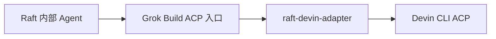

# raft-devin-adapter

[English](README.md) · [简体中文](README.zh-CN.md)

[](https://github.com/sealpp/raft-devin-adapter/actions/workflows/ci.yml)
[](LICENSE)
[](docs/compatibility.md)
[](https://github.com/sealpp/raft-devin-adapter/stargazers)

**有 Devin 账号，又想在 [Raft](https://raft.build) 里跑 Agent？你不必二选一。**

Raft 内部 Agent 绑定的运行时槽位叫 **Grok Build**——这个适配器让你本机的 Devin CLI 直接应答这个槽位：界面体验不变，底下跑的是真 Devin。原生会话恢复、执行中消息注入、按模型的思考强度控制。Windows / Linux 均可，不动 Raft 本身。



适配器负责翻译两套 ACP 方言并在两者之间转发一切：提示、中途消息、权限请求、流式更新和用量。不修改 Raft 任何文件——只是向你的 PATH 添加一个 `grok` 可执行文件，由它拉起真实的 Devin CLI。

这是一个实验性社区项目，与 Raft、Cognition、xAI 没有隶属关系。界面上的运行时仍显示为 **Grok Build**，适配器会占用本机这一可执行文件入口。安装前请阅读[兼容范围与限制](docs/compatibility.md)。

如果它解决了你把 Devin 接入 Raft 的问题，欢迎 **[点一个 Star](https://github.com/sealpp/raft-devin-adapter)**，关注后续兼容更新。也欢迎附带 CLI 版本和复现步骤提交反馈。

## 已实现能力

- 在 Raft 模型列表中展示带 `Devin · …` 前缀的模型。
- 根据 Devin 实际返回的选项，选择模型和思考强度。
- 将 Raft 的角色常驻指令作为有标记的指令块，附加到每次启动或恢复后的第一条提示。
- 使用 Devin 的 mid-turn prompt 能力，接收执行期间到达的消息。
- 转发权限请求、流式更新和用量数据。
- 在同一台电脑上使用原有 Devin 会话 ID 恢复会话，并抑制历史回放重复写入 Raft。

已在 Linux 上完成**真实端到端验证**：真实 Raft 服务器经由 Raft Computer 1.0.67 → 本适配器 → 已登录的 Devin CLI 3000.12.32 驱动 Agent，向其发送 DM 返回了真实模型推理回复。集成最初在 Windows 上使用 Raft Computer 1.0.63 验证。完整证据分级见[验证矩阵](docs/compatibility.md)。

## Linux 快速开始

准备 **Node.js 22+**、Git、可用的 Linux 版 Raft Computer，以及已安装并完成登录的 [Devin CLI](https://docs.devin.ai/)。先用官方脚本安装 Devin 并登录一次：

```sh
curl -fsSL https://cli.devin.ai/install.sh | bash   # 安装到 ~/.local/bin/devin
devin setup                                          # 登录（模型列表需要）
```

然后安装适配器：

```sh
git clone https://github.com/sealpp/raft-devin-adapter.git
cd raft-devin-adapter
platform/linux/install.sh
npm run models:refresh
platform/linux/test-adapter.sh
```

`install.sh` 构建启动器并在 `~/.local/bin` 放一个 `grok` 引导脚本——这正是 Raft 在 POSIX 上 `which grok` 失败后的回退查找目录。`models:refresh` 读取各模型的原生思考选项；`test-adapter.sh` 检查启动器的 ACP 握手和模型发现。以上命令都不会提交模型推理提示。

在 Raft 中添加**内部 Agent**，运行时选择 **Grok Build**，刷新模型列表后选择 `Devin · …` 模型。如果 Computer 的运行时清单里没有 Grok Build，请 Rescan Runtimes 或重启该 Computer，让它重新检查 `~/.local/bin/grok`。界面里的工作区 **Scan** 不会重新扫描已安装的运行时。

## Windows 快速开始

准备 **Node.js 22+**、Git、可用的 Raft Computer，以及已安装并完成登录的 [Devin CLI](https://docs.devin.ai/)。启动器使用 Windows 上 .NET Framework 4.x 自带的 C# 编译器构建。Devin 登录、账户配置和更新均通过官方 CLI 完成。

在 PowerShell 中执行：

```powershell
git clone https://github.com/sealpp/raft-devin-adapter.git
cd raft-devin-adapter
.\platform\windows\Install.ps1
.\platform\windows\Refresh-Models.ps1
.\platform\windows\Test-Adapter.ps1
```

若本机 PowerShell 执行策略阻止了你已审阅的脚本，可对单个脚本使用 `powershell.exe -NoProfile -ExecutionPolicy Bypass -File .\platform\windows\Install.ps1`。运行适配器不需要安装 npm 依赖。

`Refresh-Models.ps1` 会读取各模型的原生思考选项；`Test-Adapter.ps1` 会检查编译后启动器的 ACP 握手和模型发现。两者都会访问本机 Devin CLI，均不会提交模型推理提示。配置检查失败时，先确认官方 Devin 登录和网络正常。

若已存在另一个 `grok.exe`，安装会停止，真实 Grok 安装无法直接共用此入口。迁移**本适配器的旧目录**时，先停止相关 Agent，再执行 `Install.ps1 -ReplaceAdapter`。安装器会核对旧程序的适配器身份，并替换其用户 PATH 条目；原用户 PATH 会备份到被 Git 忽略的本地安装状态中。Linux 下对应命令为 `install.sh --replace-adapter`。

## 如何选择 SWE-2 Max

在 Raft 中选择 **Devin 的 SWE-2 模型**，将 **Reasoning effort / 推理强度设为 Max**。保留 Devin 的模型 ID `swe-2-high`，思考等级通过独立参数设置。

| Raft 中的选择 | Devin 原生配置 |
| --- | --- |
| 模型：Devin SWE-2 | `model = swe-2-high` |
| 推理强度：Medium / High / Max | `thought_level = medium / high / max` |
| 推理强度：Default | 使用所选模型的原生预设；SWE-2 目前为 High |

不会虚构 `swe-2-max` 模型 ID。适配器校验可用选项，并核对 Devin 返回的实际值；不支持的强度会明确报错。对于原生预设为 `none` 的模型，选择 Raft 的 **Default** 可保留该预设，因为 Raft 的 Grok 解析器不接受显式的 `none` 强度。

Devin CLI 升级后，请重新刷新模型目录（`platform/linux/refresh-models.sh`、`platform\windows\Refresh-Models.ps1` 或 `npm run models:refresh`）并刷新 Raft 模型列表。CLI 文件或模型列表变化会使旧缓存失效；当前选中模型还会提供实时读取的思考选项。

## 配置与代理

默认先在标准独立安装路径查找 Devin——Windows 为 `%LOCALAPPDATA%\devin\cli\bin\devin.exe`，macOS/Linux 为 `~/.local/bin/devin`（及其 `_versions/current` 实体路径）——然后查找 PATH。可选配置保存在此项目目录，被 Git 忽略：

```sh
platform/linux/install.sh --devin-exe /opt/devin/devin --proxy-url http://127.0.0.1:7890
```

```powershell
.\platform\windows\Install.ps1 -DevinExe 'C:\tools\devin\devin.exe' -ProxyUrl 'http://127.0.0.1:7890'
```

也可以将 `adapter.config.example.json` 复制为 `adapter.config.json` 后编辑。代理值留空时继承进程环境。

| 配置项 | 优先级 / 行为 |
| --- | --- |
| Devin 程序路径 | `DEVIN_EXE` → 本地 `devinExe` → 标准安装路径 → PATH |
| 代理 | `DEVIN_ADAPTER_PROXY` → 本地 `proxyUrl` → 继承环境变量 |
| 配置文件 | `DEVIN_ADAPTER_CONFIG` → 本目录 `adapter.config.json` |
| `defaultModel` | Devin 未返回当前模型时的展示 ID 兜底；以原生会话配置为准 |

显式代理只为 **Devin 子进程**设置 `HTTP_PROXY`、`HTTPS_PROXY` 和 `ALL_PROXY`，不会启动代理服务器，也不会修改系统代理，不依赖特定代理软件。代理服务需要提前运行。没有显式配置时，子进程继承 Raft Computer 的环境；仅继承环境变量不能保证流量会遵循系统代理。SOCKS 的实际支持取决于所安装的 Devin CLI。

这份独立配置保存在 Raft 目录之外，Raft 升级后仍会保留；它与代理软件设置的全局代理相互独立。请勿提交代理凭据或 Devin 账户文件。

## 更新与卸载

重建启动器前先停止使用该目录的 Agent。拉取已审阅的更新后重新构建（`platform/linux/build.sh` 或 `platform\windows\Build.ps1`）、刷新模型，再启动 Agent。如果移动了项目目录或更换了 Node 安装位置，需要在新位置重新构建并安装。

Raft 升级不会覆盖此独立目录，但 Raft 的 Grok 集成或 Devin 的 ACP 协议变化，仍可能需要适配器更新。升级任一产品后应重新验证兼容性。Devin 更新请使用官方命令；Raft 的 Grok 登录和更新按钮面向 Grok 运行时。

```sh
platform/linux/uninstall.sh        # Linux
```

```powershell
.\platform\windows\Uninstall.ps1   # Windows
```

卸载会从 PATH 移除此目录的入口（Linux 为 `~/.local/bin/grok` 引导脚本，Windows 为用户 PATH 条目），保留源码、Devin 会话和其他 PATH 项。重启 Computer 或重新扫描运行时以继承变化，并停止或重新配置使用此入口的 Agent。此前迁移掉的旧适配器入口不会自动恢复。

## 开发与验证

```sh
npm ci
npm run check
npm test
platform/linux/build.sh                 # 或 platform\windows\Build.ps1
platform/linux/test-adapter.sh --live   # 或 Test-Adapter.ps1 -Live
```

`npm test` 使用确定性的本地 ACP 测试端，无需账户、网络、模型或外部工具。CI 在 Windows / Linux、Node 22 / 24 下运行协议测试，构建两个平台的启动器，并用 fake peer 对编译产物跑全链路冒烟；另有独立 job 在无外部下载的情况下构建 Docker 验证镜像。

`--live` 会检查真实 Devin 的 SWE-2 Max、无效强度拒绝和 Default/High 行为，不发送模型提示，需先刷新模型目录。正常 Agent 任务使用你的 Devin 账户与额度。

### Docker 开发沙箱

仓库提供自包含的 Linux 开发与验证环境（Node 22 + Devin CLI，可选 Raft Computer）：

```sh
docker build -f docker/Dockerfile -t raft-devin-adapter .   # 构建即验证完整链路
docker run --rm raft-devin-adapter                          # 重新跑一遍验证套件
docker run -it raft-devin-adapter bash                      # 交互式 shell
docker build -f docker/Dockerfile --build-arg INSTALL_RAFT=1 -t raft-devin-adapter .   # 附带 raft-computer
```

构建过程会执行离线协议测试、构建启动器、把 `grok` 装上 PATH，并用与 Raft 相同的 ACP 调用序列跑通整条链路——包括不做推理的真实 `devin acp` 握手。带认证的测试（`DEVIN_API_KEY`）与 Raft Computer 的连接方式见 [docs/docker.md](docs/docker.md)。

参阅[架构](docs/architecture.md)、[贡献说明](CONTRIBUTING.md)、[Docker 环境](docs/docker.md)和[安全反馈](SECURITY.md)。

## 许可证

[MIT](LICENSE)。Raft、Devin、Grok 名称归各自权利人所有。项目不分发厂商二进制、凭据或复制的 Raft 实现文件；协议兼容不代表厂商背书。
