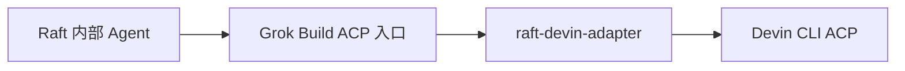

# raft-devin-adapter

[English](README.md) · [简体中文](README.zh-CN.md)

[](https://github.com/sealpp/raft-devin-adapter/actions/workflows/ci.yml)
[](LICENSE)
[](docs/compatibility.md)

**让 Devin CLI 成为 [Raft](https://raft.build) 的内部 Agent。** 通过一个轻量 ACP 兼容适配器，将 Raft 已有的 Grok Build 运行时入口接到本机 Devin CLI，支持原生会话恢复、执行中消息注入和模型思考强度选择。



适配器负责协议转换，让 Devin 在执行任务期间继续接收 Raft 消息，无需让 Agent 自己编写循环、不断读取收件箱。安装时向 Windows 用户 PATH 添加独立启动器，无需修改 Raft 程序文件。

这是一个**优先支持 Windows 的实验性社区项目**，与 Raft、Cognition、xAI 没有隶属关系。界面上的运行时仍显示为 **Grok Build**，适配器会占用本机这一可执行文件入口。安装前请阅读[兼容范围与限制](docs/compatibility.md)。

如果它解决了你把 Devin 接入 Raft 的问题，欢迎 **[点一个 Star](https://github.com/sealpp/raft-devin-adapter)**，关注后续兼容更新。也欢迎附带 CLI 版本和复现步骤提交反馈。

## 已实现能力

- 在 Raft 模型列表中展示带 `Devin · …` 前缀的模型。
- 根据 Devin 实际返回的选项，选择模型和思考强度。
- 将 Raft 的角色常驻指令作为有标记的指令块，附加到每次启动或恢复后的第一条提示。
- 使用 Devin 的 mid-turn prompt 能力，接收执行期间到达的消息。
- 转发权限请求、流式更新和用量数据。
- 在同一台电脑上使用原有 Devin 会话 ID 恢复会话，并抑制历史回放重复写入 Raft。

集成已在 Windows 上使用 **Raft Computer 1.0.63 / Devin CLI 3000.12.32** 验证。[验证矩阵](docs/compatibility.md)区分了真实 Raft 验证和离线协议测试。

## Windows 快速开始

准备 **Node.js 22+**、Git、可用的 Raft Computer，以及已安装并完成登录的 [Devin CLI](https://docs.devin.ai/)。启动器使用 Windows 上 .NET Framework 4.x 自带的 C# 编译器构建。Devin 登录、账户配置和更新均通过官方 CLI 完成。

在 PowerShell 中执行：

```powershell
git clone https://github.com/sealpp/raft-devin-adapter.git
cd raft-devin-adapter
.\Install.ps1
.\Refresh-Models.ps1
.\Test-Adapter.ps1
```

若本机 PowerShell 执行策略阻止了你已审阅的脚本，可对单个脚本使用 `powershell.exe -NoProfile -ExecutionPolicy Bypass -File .\Install.ps1`。运行适配器不需要安装 npm 依赖。

在 Raft 中添加**内部 Agent**，运行时选择 **Grok Build**，刷新模型列表后选择 `Devin · …` 模型。如果 Computer 的运行时清单里没有 Grok Build，需要通过原来的启动方式重启该 Computer，让它继承新的 PATH；现有 Agent 会短暂重启。界面里的工作区 **Scan** 不会重新扫描已安装的运行时。

`Refresh-Models.ps1` 会读取各模型的原生思考选项；`Test-Adapter.ps1` 会检查编译后启动器的 ACP 握手和模型发现。两者都会访问本机 Devin CLI，均不会提交模型推理提示。配置检查失败时，先确认官方 Devin 登录和网络正常。

若已存在另一个 `grok.exe`，安装会停止，真实 Grok 安装无法直接共用此入口。迁移**本适配器的旧目录**时，先停止相关 Agent，再执行 `Install.ps1 -ReplaceAdapter`。安装器会核对旧程序的适配器身份，并替换其用户 PATH 条目；原用户 PATH 会备份到被 Git 忽略的本地安装状态中。

## 如何选择 SWE-2 Max

在 Raft 中选择 **Devin 的 SWE-2 模型**，将 **Reasoning effort / 推理强度设为 Max**。保留 Devin 的模型 ID `swe-2-high`，思考等级通过独立参数设置。

| Raft 中的选择 | Devin 原生配置 |
| --- | --- |
| 模型：Devin SWE-2 | `model = swe-2-high` |
| 推理强度：Medium / High / Max | `thought_level = medium / high / max` |
| 推理强度：Default | 使用所选模型的原生预设；SWE-2 目前为 High |

不会虚构 `swe-2-max` 模型 ID。适配器校验可用选项，并核对 Devin 返回的实际值；不支持的强度会明确报错。对于原生预设为 `none` 的模型，选择 Raft 的 **Default** 可保留该预设，因为 Raft 的 Grok 解析器不接受显式的 `none` 强度。

Devin CLI 升级后，请重新执行 `Refresh-Models.ps1` 并刷新 Raft 模型列表。CLI 文件或模型列表变化会使旧缓存失效；当前选中模型还会提供实时读取的思考选项。

## 配置与代理

默认先从 `%LOCALAPPDATA%\devin\cli\bin\devin.exe` 查找 Devin，然后查找 PATH。可选配置保存在此项目目录，被 Git 忽略：

```powershell
.\Install.ps1 -DevinExe 'C:\tools\devin\devin.exe' -ProxyUrl 'http://127.0.0.1:7890'
```

也可以将 `adapter.config.example.json` 复制为 `adapter.config.json` 后编辑。代理值留空时继承进程环境。

| 配置项 | 优先级 / 行为 |
| --- | --- |
| Devin 程序路径 | `DEVIN_EXE` → 本地 `devinExe` → 标准安装路径 → PATH |
| 代理 | `DEVIN_ADAPTER_PROXY` → 本地 `proxyUrl` → 继承环境变量 |
| 配置文件 | `DEVIN_ADAPTER_CONFIG` → 本目录 `adapter.config.json` |
| `defaultModel` | Devin 未返回当前模型时的展示 ID 兜底；以原生会话配置为准 |

显式代理只为 **Devin 子进程**设置 `HTTP_PROXY`、`HTTPS_PROXY` 和 `ALL_PROXY`，不会启动代理服务器，也不会修改 Windows 系统代理，不依赖特定代理软件。代理服务需要提前运行。没有显式配置时，子进程继承 Raft Computer 的环境；仅继承环境变量不能保证流量会遵循 Windows 系统代理。SOCKS 的实际支持取决于所安装的 Devin CLI。

这份独立配置保存在 Raft 目录之外，Raft 升级后仍会保留；它与代理软件设置的全局代理相互独立。请勿提交代理凭据或 Devin 账户文件。

## 开发与验证

```powershell
npm ci
npm run check
npm test
.\Build.ps1
.\Test-Adapter.ps1 -Live
```

`npm test` 使用确定性的本地 ACP 测试端，无需账户、网络、模型或外部工具。CI 在 Windows / Linux、Node 22 / 24 下运行协议测试，并在 Windows 构建启动器。Linux CI 通过不代表已验证 Linux 下真实 Raft 集成。

`-Live` 会检查真实 Devin 的 SWE-2 Max、无效强度拒绝和 Default/High 行为，不发送模型提示，需先刷新模型目录。正常 Agent 任务使用你的 Devin 账户与额度。

参阅[架构](docs/architecture.md)、[贡献说明](CONTRIBUTING.md)和[安全反馈](SECURITY.md)。

## 更新与卸载

重建启动器前先停止使用该目录的 Agent。拉取已审阅的更新后执行 `Build.ps1`、刷新模型，再启动 Agent。如果移动了项目目录或更换了 Node 安装位置，需要在新位置重新构建并安装。

Raft 升级不会覆盖此独立目录，但 Raft 的 Grok 集成或 Devin 的 ACP 协议变化，仍可能需要适配器更新。升级任一产品后应重新验证兼容性。Devin 更新请使用官方命令；Raft 的 Grok 登录和更新按钮面向 Grok 运行时。

```powershell
.\Uninstall.ps1
```

卸载会从用户 PATH 和当前终端 PATH 移除此目录的条目，保留源码、Devin 会话和其他 PATH 项。重启 Computer 以继承变化，并停止或重新配置使用此入口的 Agent。此前迁移掉的旧适配器 PATH 不会自动恢复。

## 许可证

[MIT](LICENSE)。Raft、Devin、Grok 名称归各自权利人所有。项目不分发厂商二进制、凭据或复制的 Raft 实现文件；协议兼容不代表厂商背书。
