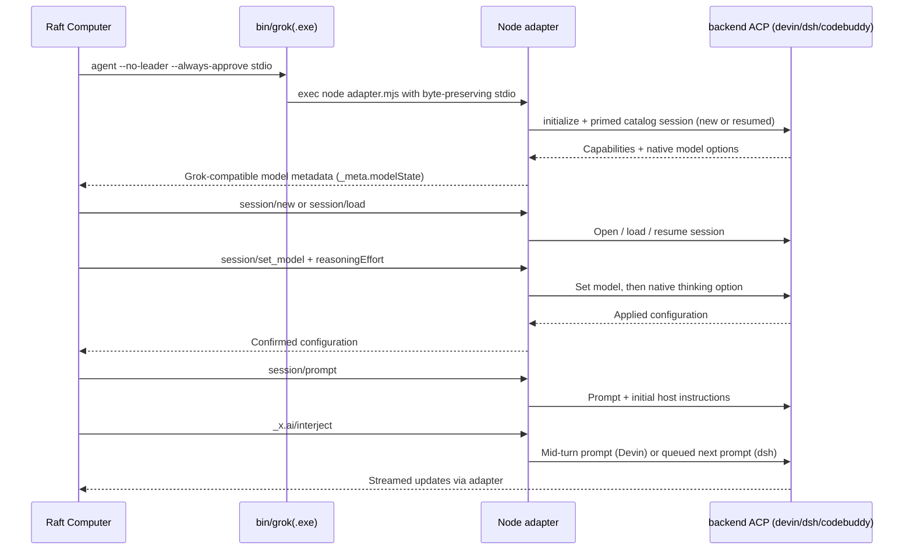

# Architecture

This repository is a local compatibility layer between two ACP dialects. It uses Raft's existing Grok Build process-launch integration while running an ACP-speaking backend — Devin CLI, DeepSeek Harness (`dsh`) or CodeBuddy Code (`codebuddy`) — as the actual agent.

## Components

| Component | Responsibility |
| --- | --- |
| `platform/windows/Launcher.cs` | Windows `grok.exe` entry point, argument quoting, flushed byte streams, process lifetime binding |
| `platform/linux/build.sh` | Generates `bin/grok`, a POSIX launcher that `exec`s Node with this checkout |
| `platform/*/install.*` | PATH installation, foreign-`grok` collision checks, optional config write |
| `src/adapter.mjs` | ACP initialization, host request forwarding, model translation, resume, interjection |
| `src/rpc.mjs` | Newline-delimited JSON-RPC subprocess transport with request timeouts |
| `src/model-config.mjs` | Native thinking metadata and catalog fingerprints |
| `src/config.mjs` | Local configuration and executable discovery |
| `scripts/refresh-models.mjs` | Read thinking choices from real model configuration, without inference |
| `scripts/fake-peer-config.mjs` | Write a config pointing the adapter at the deterministic offline peer |
| `docker/` | Self-contained Linux development and verification image |
| `docker/probe.mjs` | Drives the same ACP sequence the Raft daemon sends, through the launcher |

The launcher resolves the checkout relative to itself. Both platforms record the real Node executable path, resolving version-manager indirections, in `.local/node-path.txt`.

### Process lifetime

- **Windows**: the compiled C# launcher spawns Node and binds it to a Windows job object so the whole tree dies with the launcher.
- **Linux**: `bin/grok` ends with `exec node src/adapter.mjs "$@"`, so the launcher *is* the adapter process. This is load-bearing, not cosmetic: Raft's POSIX driver creates runtime children in their own process group and signals the launcher PID on shutdown and during model-detection probes. A wrapper script that spawned Node as a child would leave Node and the backend orphaned. When the adapter process dies, the backend child's stdin hits EOF and it exits.

### PATH installation

- **Windows**: the checkout's `bin/` directory is prepended to the persisted user PATH and the current shell's PATH.
- **Linux**: `install.sh` writes `~/.local/bin/grok`, a two-line trampoline that `exec`s this checkout's `bin/grok`. `~/.local/bin` is on PATH for standard login sessions and is also Raft's POSIX fallback discovery directory when `which grok` fails. `RAFT_ADAPTER_BIN_DIR` overrides the target directory.

## What Raft sends on the wire

Extracted from the shipped `raft-computer` daemon's Grok driver (`packages/daemon/src/drivers/grok.ts`), and mirrored by `docker/probe.mjs`:

- Launch arguments: `agent --no-leader --always-approve stdio`; runtime probe: `agent stdio --help`.
- Discovery: `which grok`, falling back to `~/.local/bin/grok` on POSIX.
- `initialize`, then `_meta.modelState.availableModels` plus per-model `_meta.reasoningEfforts` / `reasoningEffort` are read from the initialize result.
- `session/new` or `session/load` carries `_meta: { systemPromptOverride, yoloMode: true, modelId? }`; `_meta` is stripped before the native call.
- `session/set_model { sessionId, modelId, _meta: { reasoningEffort? } }`.
- Busy-turn steering is sent as `_x.ai/interject { sessionId, text, interjectionId }`.
- Agent-originated `session/request_permission` is auto-approved with `allow_once` during an always-approve active turn; other host requests receive an explicit method error.
- `authenticate` is **not** sent to this slot. The daemon maps an `-32000` initialize/session error to a `runtime_not_authenticated` state.

## Model and thinking translation

Raft receives model IDs prefixed with the backend marker — `devin:` for Devin, `dsh:` for DeepSeek Harness, `codebuddy:` for CodeBuddy Code. A selection such as `devin:swe-2-high` maps to Devin's `model=swe-2-high`; dsh model values are `[provider, model]` JSON strings used verbatim. The separate Raft `_meta.reasoningEffort` field maps to the backend's native thinking option: `thought_level` on Devin and CodeBuddy Code, `reasoning_effort` on dsh. The adapter reads back the applied thinking value and rejects unsupported strengths. Model IDs carrying another backend's prefix are rejected with a clear refresh/reselect message instead of being misrouted.

The initialization result adds `_meta.modelState.availableModels`, including per-model `_meta.reasoningEfforts` and an available default. An ignored catalog stores native choices for models other than the currently active model. Its fingerprint includes the backend executable size/mtime and native model choices; it is a cache key, not an integrity signature. Refresh it after CLI updates. dsh model options may arrive as grouped nested option lists; the adapter flattens them.

Native `none` is excluded from Raft's explicit strength vocabulary (`low medium high xhigh max ultra` — matching Raft's own `KNOWN_REASONING_EFFORTS`). A model whose preset is `none` still uses that preset when Raft selects Default. The adapter does not rewrite native model suffixes or invent model IDs for thinking levels.

## Authentication

Devin's ACP credential policy depends on the distribution channel:

- The **standalone CLI** installed by `cli.devin.ai/install.sh` (the officially documented path on every OS) accepts the local login established by `devin setup` and permits `session/new` without host authentication. This is the supported configuration.
- The **Devin Desktop-bundled** `devin` binary declares the ACP host the sole source of credentials and rejects `session/new` with `-32000` until the host calls `authenticate`.

The adapter forwards a host `authenticate` call to Devin verbatim and drops the unauthenticated primed session on success, so the next session open reflects the account's real model options. Raft's Grok driver never sends `authenticate`; the forwarding exists for hosts that do, and for distributions that require it. CodeBuddy Code needs credentials before its first `session/new`: a prior `codebuddy` sign-in on the computer, or `CODEBUDDY_API_KEY` in the environment. Its `authenticate` opens an interactive login and logs out an existing session first, so the adapter refuses that call for this backend.

## Messages, instructions, and resume

Raft's `systemPromptOverride` is removed from the native session-open call and saved in process memory. It is prepended to the first prompt after each open/resume as a marked host-instruction block. This is prompt-level forwarding; it does not replace Devin's native system prompt or guarantee instruction priority.

Grok's `_x.ai/interject` handling is per-backend. Devin advertises `cognition.ai/midTurnPrompts`: the interjection becomes a native `session/prompt` during the active turn, acknowledged after that call completes while the primary turn stays open. dsh rejects a second in-flight prompt, so interjections received while a turn is busy are queued and sent automatically as the next `session/prompt` after the turn completes — deferred delivery instead of mid-turn steering.

The same native session ID is returned to Raft. During `session/load`, replay notifications are suppressed to avoid duplicated history in the host. On dsh, `session/load` maps to `session/resume`; resume failures (`not resumable`, `cwd does not match`, `already active`) are translated into the `session not found` shape so Raft's `resume_or_fresh` recovery opens a fresh session automatically. dsh has no `session/delete` — it maps to `session/close`, and closed sessions legitimately remain in `session/list`. No transcript database is copied or translated. `session/cancel` notifications are forwarded, as are native host requests such as permission prompts. Unsupported host extension requests return an explicit method error.

Capability requirements are per-backend. Devin must advertise session loading plus `cognition.ai/midTurnPrompts`; dsh instead reports `sessionCapabilities: { close, list, resume }` and no `loadSession`, which the adapter injects because resume satisfies the same contract. A missing required capability fails the handshake rather than silently weakening message delivery. CodeBuddy Code advertises `loadSession` and no session capabilities. It has no `session/close`, `session/delete` or `session/list`, so the adapter forgets closed sessions locally. Its `session/load` for an unknown ID succeeds with a blank session instead of an error, which would stop Raft's fresh-session recovery. The adapter therefore answers `session not found` for any ID it did not create (sessions are recorded under `.local/codebuddy-sessions/`), so Raft's recovery runs as it does for DSH. Active-turn messages are deferred (`midTurn: false`). CodeBuddy queues a second prompt sent during a turn and runs it afterwards, but acknowledges it at once with `end_turn`; deferral keeps each reply attached to its own Raft turn. The follow-up is sent as its own prompt, and the Raft turn does not finish until it has run (`queuesPrompts`). Token usage arrives per request in `usage_update` notifications, which the adapter forwards unchanged; it also sums them into the prompt result's `_meta.usage` in ACP's usage shape. Every opened session is switched to CodeBuddy's `fullAccess` mode through `session/set_config_option` (`mode`) — a true full pass including dangerous-command checks, matching the `approvalPolicy: "never"` + `danger-full-access` posture Raft gives Codex; a missing or rejected option only logs a warning.

Because dsh sessions cannot be deleted, the primed catalog session created during `initialize` is persisted in adapter-local state (`backend-state.json`, keyed by backend) and resumed by its stored ID with `session/resume` in later processes. `RAFT_ADAPTER_LOCAL` redirects the local-state directory for isolation.

## Local state

| Location | Contents |
| --- | --- |
| `bin/` | Locally generated launcher (`grok` or `grok.exe`) |
| `.local/` | Node path, model catalog, Windows PATH backup, dsh primed-session state |
| `adapter.config.json` | Optional local executable and proxy configuration |
| `~/.local/bin/grok` | Linux PATH trampoline created by `install.sh` |
| `backend-state.json` in `.local/` | Primed catalog session reuse (per backend) |
| `codebuddy-sessions/` in `.local/` | CodeBuddy session IDs this adapter created; the only sessions it loads on resume |
| Official backend storage | Authentication and native sessions, managed by Devin/dsh (`~/.dsh`) |

All generated and machine-specific adapter files are ignored by Git. The public repository has no runtime npm dependencies and does not contain Raft, Devin, DeepSeek, or Grok source or binaries. Advanced tests may override the native process arguments with local `devinArgs` / `dshArgs` string arrays; normal usage keeps the defaults (`['acp']`).
