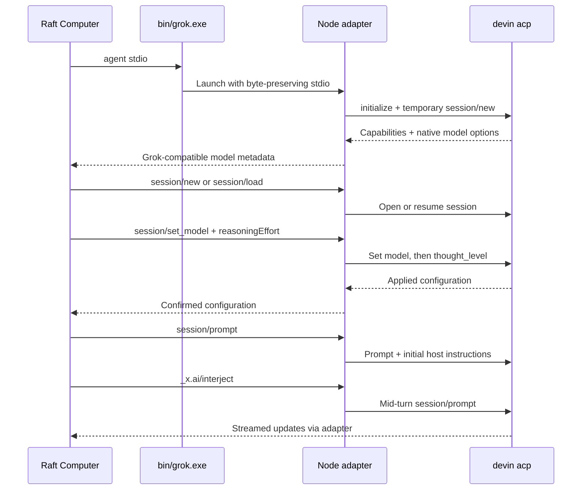

# Architecture

This repository is a local compatibility layer between two ACP dialects. It uses Raft's existing Grok Build process-launch integration while running Devin as the actual agent.

## Components

| Component | Responsibility |
| --- | --- |
| `scripts/Launcher.cs` | Windows `grok.exe` entry point, argument quoting, flushed byte streams, process lifetime binding |
| `src/adapter.mjs` | ACP initialization, host request forwarding, model translation, resume, interjection |
| `src/rpc.mjs` | Newline-delimited JSON-RPC subprocess transport with request timeouts |
| `src/model-config.mjs` | Native thinking metadata and catalog fingerprints |
| `src/config.mjs` | Local configuration and executable discovery |
| `scripts/refresh-models.mjs` | Read thinking choices from real model configuration, without inference |

The launcher resolves the checkout relative to itself. `Build.ps1` records the real Node executable path, resolving version-manager junctions, in `.local/node-path.txt`. A Windows job object ties Node and its inheriting child processes to the launcher; a binding failure produces an error. No executable is downloaded by the build script.

## Model and thinking translation

Raft receives model IDs prefixed with `devin:`. A selection such as `devin:swe-2-high` maps to Devin's `model=swe-2-high`. The separate Raft `_meta.reasoningEffort` field maps to native `thought_level`. The adapter reads back the applied thinking value and rejects unsupported strengths.

The initialization result adds `_meta.modelState.availableModels`, including per-model `_meta.reasoningEfforts` and an available default. An ignored catalog stores native choices for models other than the currently active model. Its fingerprint includes the Devin executable size/mtime and native model choices; it is a cache key, not an integrity signature. Refresh it after CLI updates.

Native `none` is excluded from Raft's explicit strength vocabulary. A model whose preset is `none` still uses that preset when Raft selects Default. The adapter does not rewrite native model suffixes or invent model IDs for thinking levels.

## Messages, instructions, and resume

Raft's `systemPromptOverride` is removed from the native session-open call and saved in process memory. It is prepended to the first prompt after each open/resume as a marked host-instruction block. This is prompt-level forwarding; it does not replace Devin's native system prompt or guarantee instruction priority.

Grok's `_x.ai/interject` becomes a native `session/prompt` sent during the active turn. The adapter acknowledges acceptance after that call completes and keeps the primary turn open until tracked injections settle. This uses Devin's advertised mid-turn capability, rather than a polling loop.

The same native session ID is returned to Raft. During `session/load`, replay notifications are suppressed to avoid duplicated history in the host. No transcript database is copied or translated. `session/cancel` notifications are forwarded, as are native host requests such as permission prompts. Unsupported host extension requests return an explicit method error.

Initialization requires both native session loading and `cognition.ai/midTurnPrompts`. A missing capability fails the handshake rather than silently weakening message delivery.

## Local state

| Location | Contents |
| --- | --- |
| `bin/` | Locally compiled launcher |
| `.local/` | Node path, catalog, original user PATH backup |
| `adapter.config.json` | Optional local executable and proxy configuration |
| Official Devin storage | Authentication and native sessions, managed by Devin |

All generated and machine-specific adapter files are ignored by Git. The public repository has no runtime npm dependencies and does not contain Raft, Devin, or Grok source or binaries. Advanced tests may override the native process arguments with a local `devinArgs` string array; normal usage keeps the default `['acp']`.
